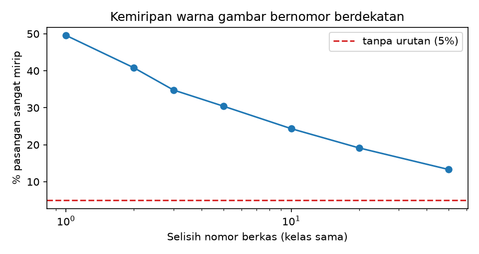
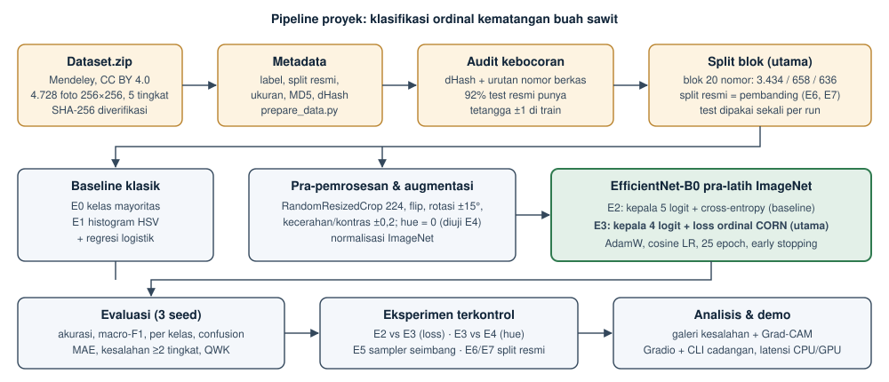

# Klasifikasi Ordinal Tingkat Kematangan Tandan Buah Segar Kelapa Sawit dari Citra Lapangan: Perbandingan Cross-Entropy dan CORN pada EfficientNet-B0

**Proposal Proyek Akhir Visi Komputer (UTS)** · Mata kuliah IF0PP006 · Kelas 5PITA · Semester Ganjil 2026/2027

## 1. Judul dan identitas kelompok

| | |
|---|---|
| Kelompok | 3 |
| Anggota | Juanito Dante (412024001) · Yedija Teofilus Yonatan (412024011) · Steven Iwan (412024010) |
| Judul singkat berkas | `K03_KematanganSawit` |
| Jenis tugas visi komputer | Klasifikasi citra **ordinal** (5 tingkat berurutan) |
| Repositori kode | `K03_KematanganSawit/` (tautan repositori diisi pada tracker) |

## 2. Latar belakang dan masalah

Indonesia adalah produsen minyak sawit terbesar di dunia, dan sebagian besar kebunnya dikelola pekebun rakyat. Tandan buah segar (TBS) yang dipanen dinilai mutunya di pabrik kelapa sawit (PKS) berdasarkan **tingkat kematangan**, yang memengaruhi harga yang diterima pekebun. TBS yang terlalu mentah menghasilkan rendemen minyak rendah, sedangkan TBS yang lewat matang atau busuk cenderung menaikkan kadar asam lemak bebas (ALB) dan menurunkan mutu minyak. Saat ini penilaian (*grading*) dilakukan secara visual oleh petugas, sehingga hasilnya bisa berbeda antarpetugas dan menjadi sumber perselisihan antara pekebun dan pabrik.

**Penerima manfaat.** (1) Pekebun dan pengepul yang ingin memeriksa sendiri tingkat kematangan sebelum menjual; (2) petugas sortir yang membutuhkan pendapat kedua yang konsisten; (3) peneliti yang membutuhkan tolok ukur (*benchmark*) terbuka untuk penilaian kematangan.

**Mengapa visi komputer.** Isyarat kematangan TBS terutama bersifat visual: warna kulit buah berubah dari ungu kehitaman (mentah) ke merah-oranye (matang), lalu kusam/gelap (lewat matang/busuk), disertai perubahan tekstur dan brondolan. Isyarat ini dapat ditangkap kamera ponsel tanpa alat ukur khusus.

**Mengapa ordinal.** Kelima kelas pada dataset tidak setara: kelas-kelasnya **berurutan**, yaitu *Mentah < Setengah Matang < Matang Penuh < Terlalu Matang < Busuk*. Salah menilai "Mentah" sebagai "Setengah Matang" jauh lebih ringan akibatnya daripada salah menilai "Mentah" sebagai "Terlalu Matang". Klasifikasi biasa dengan *cross-entropy* (CE) memperlakukan semua kesalahan sama berat dan mengabaikan urutan ini. Penyusun dataset sendiri menyebut dataset dirancang untuk *ordinal regression* (Kamal dkk., 2024), sedangkan pekerjaan klasifikasi kematangan sawit yang kami temukan umumnya memakai klasifikasi nominal (Suharjito dkk., 2021).

**Batas klaim.** Proyek ini **tidak** mengklaim sistem siap dipakai di pabrik. Model hanya dievaluasi pada foto dari satu wilayah (Kalimantan Tengah) dengan label dari satu tim ahli; hasilnya tidak otomatis berlaku untuk foto tumpukan TBS di PKS, malam hari, atau varietas lain.

## 3. Tujuan, pertanyaan proyek, batasan, dan ukuran keberhasilan

**Tujuan.** Membangun dan mengevaluasi secara adil model klasifikasi 5 tingkat kematangan TBS dari satu foto, dengan perhatian khusus pada *jarak* kesalahan, serta menyediakan demo yang menerima foto baru.

**Pertanyaan proyek** (P1 dan P3 ditetapkan sebelum ada data; P2 dipertajam setelah audit data, **sebelum** ada hasil model):

- **P1 (utama).** Dengan backbone, data, augmentasi, dan seed yang sama, apakah loss ordinal **CORN** menurunkan **MAE** (dalam satuan tingkat) dan **proporsi kesalahan berat** (meleset ≥ 2 tingkat) dibanding **cross-entropy**, tanpa menurunkan macro-F1 lebih dari 0,02?
- **P2 (validitas data).** Audit awal menemukan bahwa foto bernomor berurutan sering berasal dari tandan atau sesi yang sama, sementara split resmi membaginya secara acak. Seberapa jauh skor pada split resmi lebih optimistis dibanding **split blok** yang menjaga foto berurutan tetap bersama, dan apakah urutan CE vs CORN tetap sama pada kedua split?
- **P3 (augmentasi).** Karena warna adalah isyarat utama, apakah augmentasi *hue/saturation jitter* menurunkan kinerja model CORN?

**Batasan ruang lingkup.** Satu dataset publik; satu foto → satu label (bukan deteksi banyak tandan); satu arsitektur utama (EfficientNet-B0) dengan dua jenis kepala; tanpa pengumpulan data baru; tanpa *deployment* ke perangkat seluler (demo berbasis web).

**Ukuran keberhasilan.**

| Tingkat | Kriteria |
|---|---|
| Minimum | Pipeline dapat diulang dari awal (unduh → audit → latih → evaluasi) dengan seed tetap; CNN (E2) mengungguli baseline warna HSV (E1) pada macro-F1. |
| Target P1 | Pada split blok, rerata 3 seed: MAE E3 < MAE E2 **dan** kesalahan berat E3 < E2, dengan arah perbaikan konsisten pada ≥ 2 dari 3 pasangan seed, dan macro-F1 E3 ≥ macro-F1 E2 − 0,02. |
| Target P2 | Selisih skor split resmi − split blok dilaporkan untuk baseline warna (E1), CE (E6 vs E2), dan CORN (E7 vs E3). |
| Demo | Foto baru menghasilkan prediksi, peluang per tingkat, dan Grad-CAM; latensi model di CPU < 200 ms per gambar. |

Hasil negatif (CORN tidak lebih baik) tetap dilaporkan apa adanya beserta analisis penyebabnya.

## 4. Rujukan terkait dan posisi proyek

| Rujukan | Isi singkat | Relevansi untuk proyek |
|---|---|---|
| Kamal dkk. (2024), dataset Mendeley | 4.728 foto TBS lapangan, 5 tingkat ordinal, split stratified resmi | **Dataset utama**; menyarankan *ordinal regression* dan penanganan ketidakseimbangan kelas |
| Suharjito dkk. (2021), *Comput. Electron. Agric.* | Klasifikasi kematangan TBS di perangkat seluler dengan CNN ringan | Contoh pendekatan nominal (CE) dan perhatian pada efisiensi; dasar pemilihan backbone ringan |
| Suharjito dkk. (2023), *Scientific Data* | Dataset tumpukan TBS di pabrik untuk *grading* | Menunjukkan domain lain (tumpukan di PKS) yang **di luar** cakupan kami; batas klaim |
| Omar dkk. (2024), *Data in Brief* | Dataset kematangan sawit di luar ruangan | Dataset alternatif/pembanding domain bila ada waktu |
| Cao, Mirjalili & Raschka (2020), *Pattern Recognit. Lett.* — **CORAL** | Regresi ordinal pada jaringan saraf dengan K−1 tugas biner berbagi bobot | Dasar teori pendekatan ordinal berbasis tugas biner |
| Shi, Cao & Raschka (2023), *Pattern Anal. Appl.* — **CORN** | Tugas biner **bersyarat**; konsisten peringkat tanpa batasan bobot | **Metode utama** (paper metode #1) |
| Tan & Le (2019), *ICML* — **EfficientNet** | Skala jaringan seimbang; B0 = 5,3 juta parameter | **Backbone** (paper metode #2) |
| Selvaraju dkk. (2017), *ICCV* — **Grad-CAM** | Peta panas area yang memengaruhi keputusan CNN | Analisis kesalahan dan demo |
| Kaufman dkk. (2012); Kapoor & Narayanan (2023) | Kebocoran data sebagai sumber hasil yang terlalu optimistis | Dasar audit *near-duplicate* (P2) |
| Cohen (1968) | *Weighted kappa* | Metrik QWK untuk data ordinal |

**Posisi proyek.** Kami tidak mengusulkan arsitektur baru. *Gap* yang diisi bersifat evaluatif: (a) membandingkan secara terkontrol loss nominal vs ordinal pada dataset ordinal yang baru dirilis, dengan metrik yang memperhitungkan jarak kesalahan; (b) mengukur seberapa optimistis split acak resmi akibat foto beruntun dari tandan atau sesi yang sama, lalu menyediakan split blok yang lebih jujur.

## 5. Dataset

| Unsur | Keterangan |
|---|---|
| Nama | *An Ordinal Dataset for Ripeness Level Classification in Oil Palm Fruit Quality Grading* (versi 1, rilis 26 Nov 2024) |
| Sumber | Mendeley Data, DOI [10.17632/424y96m6sw.1](https://doi.org/10.17632/424y96m6sw.1); Kamal, Mochammad, Nurahmi (ITS), Natawijaya, Kalili; didanai Bumitama Innovation Center |
| Lisensi | **CC BY 4.0**: boleh dipakai, diubah, dan dibagikan dengan atribusi |
| Ukuran | `Dataset.zip` 272 MB; **4.728 JPG**, seluruhnya **256×256 piksel** (sudah diperkecil penyusun); median ukuran berkas ~58 KB |
| Kelas | 0 Mentah (758), 1 Setengah Matang (1.405), 2 Matang Penuh (1.489), 3 Terlalu Matang (665), 4 Busuk (411) |
| Karakteristik | Foto lapangan di Kalimantan Tengah, beragam perangkat, pencahayaan, pose, dan latar alami; kategori tingkat kematangan didefinisikan dengan masukan ahli |
| Split resmi | train 3.306 / validasi 704 / test 718 (acak stratified, ~70/15/15); dipakai sebagai **pembanding** (E6, E7) |
| Split utama | **split blok**: train 3.434 / validasi 658 / test 636, dibuat oleh audit kami dan dibekukan di `data/splits/grouped_split.csv` |
| Akses | Terbuka; unduhan otomatis + verifikasi SHA-256 (`scripts/download_data.py`) |

Distribusi split resmi (diperiksa langsung dari arsip resmi, lihat `bukti_kelayakan_data.md`):

| Split | Mentah | Setengah Matang | Matang Penuh | Terlalu Matang | Busuk | Total |
|---|---|---|---|---|---|---|
| Train | 530 | 982 | 1.042 | 465 | 287 | 3.306 |
| Validasi | 113 | 210 | 222 | 98 | 61 | 704 |
| Test | 115 | 213 | 225 | 102 | 63 | 718 |

**Risiko bias dan kebocoran.**

- *Ketidakseimbangan kelas*: Matang Penuh 3,6× lebih banyak daripada Busuk. Karena akurasi bisa menyesatkan, kami melaporkan macro-F1 dan recall per kelas, dan menguji *sampler* seimbang (E5).
- *Kebocoran karena pemotretan beruntun* (**terbukti pada audit awal**, lihat bagian 5.1).
- *Jalan pintas (shortcut) resolusi*: tidak ada, karena seluruh gambar berukuran 256×256. Perangkat dan latar tetap dapat berkorelasi dengan kelas; hal ini diperiksa dengan Grad-CAM.
- *Bias domain*: satu wilayah dan satu tim pelabel; tidak ada data tumpukan di PKS atau malam hari.
- *Ambiguitas label*: batas antar-tingkat bertetangga bersifat kontinu; karena itu kami juga melaporkan *off-by-one accuracy* dan memeriksa pasangan *near-duplicate* yang labelnya berbeda.

### 5.1 Hasil audit awal pada data asli

Dataset telah diunduh (SHA-256 cocok), lalu `scripts/audit_dataset.py` dan kedua baseline klasik dijalankan di CPU. Seluruh angka berikut dihasilkan skrip dan tersimpan di `results/`.

1. **Duplikat persis dan *near-duplicate* (dHash ≤ 5):** 1 pasangan berkas identik dan 13 pasangan *near-duplicate*. Pemeriksaan visual menunjukkan semuanya memang foto tandan yang sama, dan **semua pasangan bernomor berkas berurutan**. Hanya 6 gambar test (0,8%) yang terdeteksi oleh dHash.
2. **Pemotretan beruntun:** dHash hanya menangkap foto yang nyaris identik, sehingga kami membandingkan fitur warna HSV antara gambar sekelas yang nomornya berselisih k dengan pasangan acak (Tabel 5.1). Bila nomor berkas tidak berkaitan dengan urutan pemotretan, sekitar 5% pasangan akan "sangat mirip". Ternyata **50% pasangan berurutan sangat mirip**, dan angka ini menurun perlahan hingga selisih puluhan nomor. Artinya foto bernomor berdekatan kemungkinan besar berasal dari tandan atau sesi yang sama.
3. **Dampak pada split resmi:** **92% gambar test resmi (662/718)** memiliki tetangga bernomor ±1 di train.
4. **Keputusan (sesuai rencana cadangan di bagian 8):** kami membuat **split blok**. Nomor berkas tiap kelas dibagi menjadi blok 20 nomor berurutan, digabung dengan kelompok dHash, lalu dibagi dengan *StratifiedGroupKFold* (seed 42). Hanya 8,3% gambar test split blok yang bertetangga ±1 dengan train, yaitu yang berada di batas blok. Split ini dibekukan sebagai berkas agar tidak berubah antarversi scikit-learn. Split blok menjadi split utama; split resmi menjadi pembanding.

**Tabel 5.1.** Kemiripan warna gambar sekelas menurut selisih nomor berkas.

| Selisih nomor k | 1 | 2 | 3 | 5 | 10 | 20 | 50 |
|---|---|---|---|---|---|---|---|
| % pasangan lebih mirip dari persentil-5 pasangan acak (harapan tanpa urutan: 5%) | 49,6 | 40,8 | 34,8 | 30,4 | 24,4 | 19,1 | 13,3 |

**Tabel 5.2.** Baseline klasik pada kedua split (lingkungan yang sama dengan pelatihan CNN, Google Colab).

| Baseline | Split | n test | Akurasi | Macro-F1 | MAE | Kesalahan berat | QWK |
|---|---|---|---|---|---|---|---|
| E0 kelas mayoritas | blok | 636 | 0,314 | 0,096 | 0,892 | 0,206 | 0,000 |
| E1 HSV + regresi logistik | blok | 636 | 0,679 | 0,657 | 0,506 | 0,129 | 0,607 |
| E1 HSV + regresi logistik | resmi | 718 | 0,689 | 0,681 | 0,468 | 0,120 | 0,670 |

Bahkan baseline warna yang sederhana mendapat akurasi 1,0 poin dan macro-F1 2,4 poin lebih tinggi pada split resmi. CNN yang lebih mampu menghafal diperkirakan terdampak lebih besar; hal ini diuji pada E6/E7. Subset test "bersih" versi dHash (712 gambar) memberikan skor yang hampir sama dengan test penuh, sehingga subset itu **tidak** cukup untuk mengatasi kebocoran.

**Konfirmasi manual.** Tim memberi label pada 40 pasangan foto berurutan yang dipilih acak (`results/audit/cek_manual_pasangan_berurutan.csv`, ringkasan di `hasil_cek_manual.md`). Hasilnya: 18 tandan sama, 11 berbeda, dan 11 ragu (foto gelap/terang, tertutup tangan, atau terlalu dekat). Di antara pasangan yang dapat diputuskan, **62%** adalah tandan yang sama (IK 95% 44–77%); batas bawahnya 45% bila semua "ragu" dihitung berbeda. Dari 18 pasangan tandan sama, **6 terpisah antara train dan val/test pada split resmi, dan 0 pada split blok**. Keterbatasan: sampel kecil dan pelabel bukan ahli sawit.

## 6. Metodologi

**Baseline** (dijalankan pada split yang sama dengan model utama, yaitu split blok, serta pada split resmi sebagai pembanding):

- **E0 – kelas mayoritas**: batas bawah.
- **E1 – histogram HSV + regresi logistik**: 40 fitur warna (histogram H 18 bin, S 8, V 8, serta rerata dan simpangan baku tiap kanal). Hiperparameter C dipilih dari macro-F1 validasi. Baseline ini menguji seberapa jauh "warna saja" sudah cukup.
- **E2 – EfficientNet-B0 + cross-entropy**: baseline deep learning dan pembanding langsung metode utama.

**Metode utama – E3: EfficientNet-B0 + CORN.**

- *Arsitektur*: EfficientNet-B0 pra-latih ImageNet (torchvision). Lapisan klasifikasi diganti dengan Dropout(0,2) + Linear(1280 → K−1 = 4). Alasan: akurasi ImageNet yang baik dengan hanya 5,3 juta parameter dan latensi rendah, sehingga cocok untuk Colab gratis dan demo CPU.
- *Loss CORN* (Shi dkk., 2023): logit ke-k memodelkan P(y > k | y > k−1). Tugas k hanya dilatih pada sampel dengan y ≥ k menggunakan BCE. Peluang tak bersyarat P(y > k) = ∏ᵢ≤ₖ σ(logitᵢ) monoton turun, sehingga prediksi = jumlah k dengan P(y > k) > 0,5. Distribusi 5 kelas untuk tampilan diperoleh dari selisih peluang kumulatif.
- *Strategi fine-tuning*: seluruh lapisan dilatih (*full fine-tuning*) karena domain (foto kebun) cukup jauh dari ImageNet dan datanya ribuan gambar.
- *Pra-pemrosesan*: latih dengan `RandomResizedCrop(224, skala 0,6–1)`; evaluasi dengan resize sisi pendek 256 lalu *center crop* 224; normalisasi ImageNet.
- *Augmentasi*: flip horizontal/vertikal, rotasi ±15°, kecerahan dan kontras ±0,2. **Hue dan saturasi tidak diubah** pada konfigurasi dasar karena warna adalah isyarat kematangan; pengaruhnya diuji pada E4.
- *Konfigurasi inti*: AdamW (lr 3·10⁻⁴, *weight decay* 10⁻²), *warmup* 1 epoch lalu *cosine decay*, *batch* 32, maksimal 25 epoch, *early stopping* (kesabaran 7), *mixed precision* di GPU. Checkpoint dipilih dari **macro-F1 validasi** untuk semua eksperimen. Macro-F1 netral terhadap kedua loss, sehingga pemilihan model tidak menguntungkan metode utama.

**Kontrol perbandingan.** E2 dan E3 hanya berbeda pada kepala/loss; konfigurasi lain, termasuk split blok, diwarisi dari berkas yang sama (`configs/base.yaml`). Setiap eksperimen CNN diulang dengan seed 42, 43, dan 44.

## 7. Rencana evaluasi, eksperimen terkontrol, dan analisis kesalahan

**Metrik.** Sesuai panduan untuk klasifikasi: akurasi, **macro-F1**, precision/recall per kelas, dan *confusion matrix*. Ditambah metrik ordinal: **MAE**, **proporsi kesalahan berat** (|ŷ − y| ≥ 2), akurasi ±1 tingkat, dan **QWK**. Semua dilaporkan sebagai rerata ± simpangan baku dari 3 seed, ditambah selisih berpasangan per seed (E3 − E2).

**Eksperimen.**

| ID | Perlakuan | Menjawab |
|---|---|---|
| E0, E1 | Baseline klasik (split blok dan split resmi) | batas bawah dan "warna saja" |
| E2 vs **E3** | CE vs CORN (satu-satunya perbedaan), split blok | **P1** |
| E3 vs E4 | + augmentasi hue 0,1 & saturasi 0,2 | P3 |
| E3 vs E5 | + sampler seimbang kelas (iterasi setelah analisis kesalahan) | perbaikan kelas minoritas |
| E6 vs E2, E7 vs E3 | model yang sama pada split resmi (acak) vs split blok | **P2** |

**Aturan test set.** Test set hanya dievaluasi sekali per run, setelah checkpoint dipilih dari validasi. Test set tidak dipakai untuk memilih hiperparameter, ambang, atau epoch.

**Analisis kesalahan.** Untuk E2 dan E3 kami akan menyusun: pasangan kelas yang paling sering tertukar; galeri kesalahan berat dan kesalahan tetangga dengan keyakinan tertinggi; Grad-CAM pada kesalahan; akurasi per rentang keyakinan untuk menetapkan ambang peringatan demo; serta kategori manual (pencahayaan, latar ramai, oklusi, banyak tandan, blur, label ambigu).

## 8. Rencana kerja, peran, komputasi, risiko, dan alternatif

**Peran** (dapat diputar setelah UTS; setiap anggota wajib memahami seluruh pipeline):

| Anggota | Peran utama | Tanggung jawab |
|---|---|---|
| Yedija Teofilus | Koordinator; PJ dokumentasi & demo | tracker, proposal/laporan, demo Gradio, latensi |
| Juanito Dante | PJ data | unduh & audit dataset, pemeriksaan manual *near-duplicate*, kartu dataset |
| Steven Iwan | PJ model & eksperimen | konfigurasi, pelatihan E2–E7, tabel hasil, analisis kesalahan |

**Jadwal** (mengikuti checkpoint panduan):

| Minggu | Checkpoint | Keluaran |
|---|---|---|
| 3 | CP00, CP01 | kontrak kerja; matriks tiga kandidat; keputusan topik |
| 4 | CP02, CP03 | rumusan masalah + 5 rujukan; audit dataset |
| 5 | CP04 | baseline E0/E1 dan ukuran sukses |
| 6 | CP05 | diagram pipeline, konfigurasi inti, rencana kontrol |
| 7 | CP06 | bukti kelayakan + proposal beku + slide |
| 8 | **UTS** | sidang proposal |
| 9–10 | CP07, CP08 | repo + loader + split tetap; E2 berjalan |
| 11–12 | CP09, CP10 | E3 versi 1; tabel E2–E7 (3 seed) |
| 13 | CP11 | analisis kesalahan; iterasi E5 |
| 14 | CP12 | demo + latensi + video cadangan |
| 15 | CP13 | artefak beku, laporan, slide |
| 16 | **UAS** | demo dan sidang hasil |

**Kebutuhan komputasi.** Google Colab gratis (GPU T4, 2 vCPU). Perkiraan 8–12 menit per run EfficientNet-B0, sehingga 6 eksperimen × 3 seed = 18 run ≈ 2,5–3,5 jam GPU yang dapat dibagi beberapa sesi (skrip melewati run yang sudah selesai). Di CPU laptop kelompok (Ryzen 5 5600) satu batch latih butuh ~1,5 detik, atau lebih dari 1 jam per run, sehingga pelatihan dilakukan di Colab. Audit dan baseline klasik cukup dijalankan di CPU (< 1 menit). Penyimpanan sekitar 0,3 GB data dan sekitar 16 MB per checkpoint.

**Risiko dan alternatif.**

| Risiko | Dampak | Mitigasi / rencana cadangan |
|---|---|---|
| Kuota GPU Colab habis | eksperimen tertunda | 1 seed dulu untuk semua eksperimen, lalu seed tambahan; cadangan GPU Kaggle |
| Banyak *near-duplicate* lintas split (**terjadi**: 92% test resmi bertetangga dengan train) | skor resmi terlalu optimistis | **sudah diterapkan**: split blok menjadi split utama; split resmi menjadi pembanding (E6, E7) |
| CORN tidak lebih baik dari CE | P1 negatif | tetap dilaporkan dengan analisis; tetap valid menurut rubrik |
| Tautan unduhan Mendeley berubah | data tidak dapat diakses | salinan zip di Drive kelompok (diizinkan CC BY), verifikasi SHA-256 |
| Label tingkat bertetangga ambigu | batas akurasi rendah | laporkan akurasi ±1 dan contoh pasangan berlabel beda |
| Demo gagal saat sidang | nilai demo turun | CLI `scripts/predict.py` + video cadangan 2–3 menit |
| Topik tidak layak sama sekali | — | kandidat cadangan dari CP01: klasifikasi kesegaran ikan dari citra mata (dataset FFE) |

## Referensi

1. Kamal, I. M., Mochammad, S., Nurahmi, L., Natawijaya, A., & Kalili, M. (2024). *An Ordinal Dataset for Ripeness Level Classification in Oil Palm Fruit Quality Grading* (Version 1) [Data set]. Mendeley Data. https://doi.org/10.17632/424y96m6sw.1
2. Shi, X., Cao, W., & Raschka, S. (2023). Deep neural networks for rank-consistent ordinal regression based on conditional probabilities. *Pattern Analysis and Applications, 26*(3), 941–955. https://doi.org/10.1007/s10044-023-01181-9
3. Cao, W., Mirjalili, V., & Raschka, S. (2020). Rank consistent ordinal regression for neural networks with application to age estimation. *Pattern Recognition Letters, 140*, 325–331. https://doi.org/10.1016/j.patrec.2020.11.008
4. Tan, M., & Le, Q. V. (2019). EfficientNet: Rethinking model scaling for convolutional neural networks. *Proceedings of the 36th International Conference on Machine Learning*, PMLR 97, 6105–6114.
5. Suharjito, Elwirehardja, G. N., & Prayoga, J. S. (2021). Oil palm fresh fruit bunch ripeness classification on mobile devices using deep learning approaches. *Computers and Electronics in Agriculture, 188*, 106359. https://doi.org/10.1016/j.compag.2021.106359
6. Suharjito, Junior, F. A., Koeswandy, Y. P., Debi, Nurhayati, P. W., Asrol, M., & Marimin. (2023). Annotated datasets of oil palm fruit bunch piles for ripeness grading using deep learning. *Scientific Data, 10*, 72. https://doi.org/10.1038/s41597-023-01958-x
7. Omar, Z., Abdul Majeed, A. P. P., Rosbi, M., Ghazalli, S. A., & Selamat, H. (2024). Outdoor oil palm fruit ripeness dataset. *Data in Brief, 55*, 110667. https://doi.org/10.1016/j.dib.2024.110667
8. Selvaraju, R. R., Cogswell, M., Das, A., Vedantam, R., Parikh, D., & Batra, D. (2017). Grad-CAM: Visual explanations from deep networks via gradient-based localization. *ICCV 2017*, 618–626. https://doi.org/10.1109/ICCV.2017.74
9. Kaufman, S., Rosset, S., Perlich, C., & Stitelman, O. (2012). Leakage in data mining. *ACM Transactions on Knowledge Discovery from Data, 6*(4), 1–21. https://doi.org/10.1145/2382577.2382579
10. Kapoor, S., & Narayanan, A. (2023). Leakage and the reproducibility crisis in machine-learning-based science. *Patterns, 4*(9), 100804. https://doi.org/10.1016/j.patter.2023.100804
11. Cohen, J. (1968). Weighted kappa: Nominal scale agreement provision for scaled disagreement or partial credit. *Psychological Bulletin, 70*(4), 213–220. https://doi.org/10.1037/h0026256
