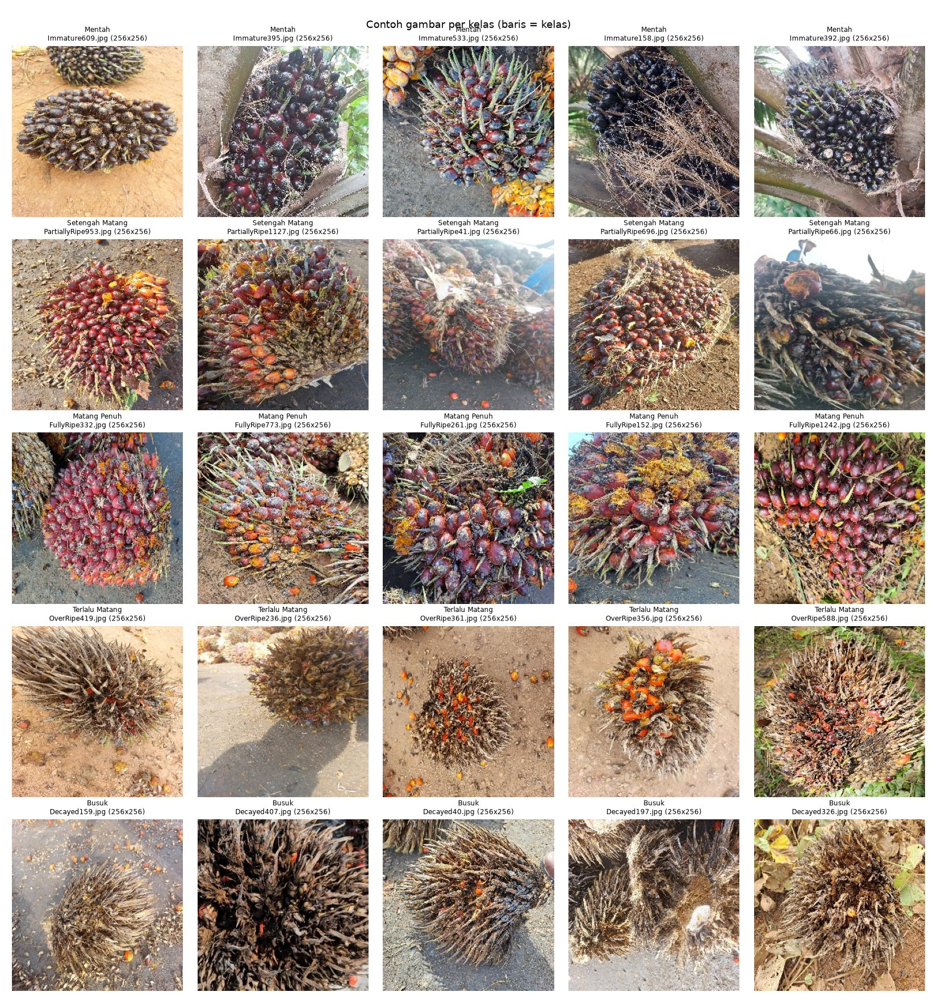
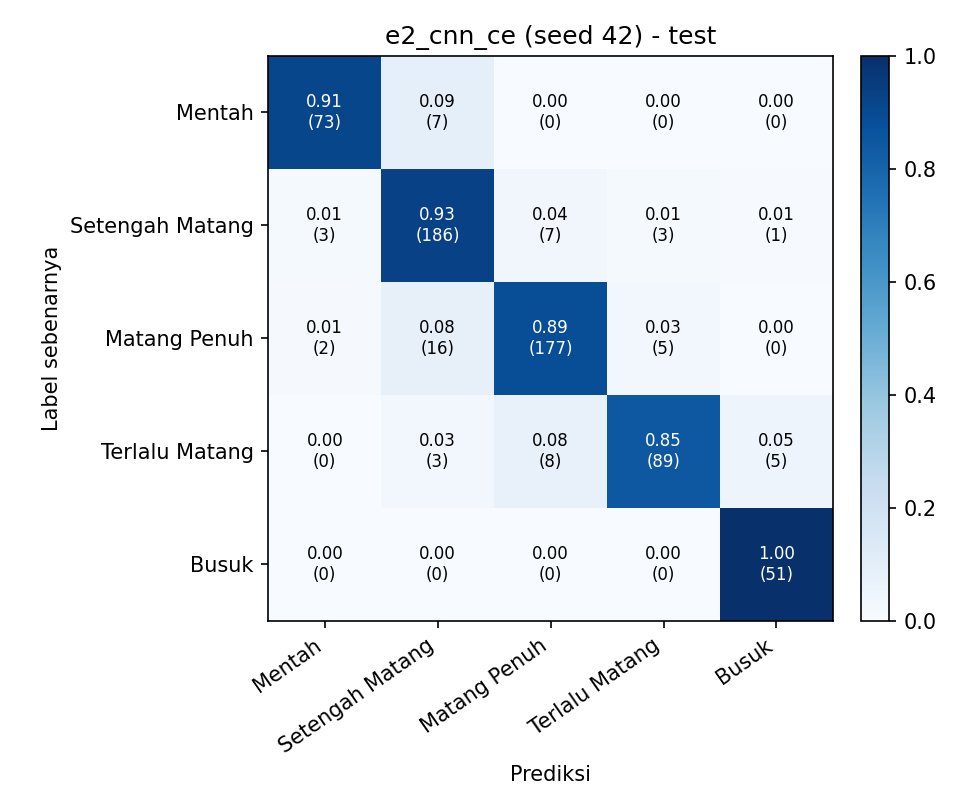
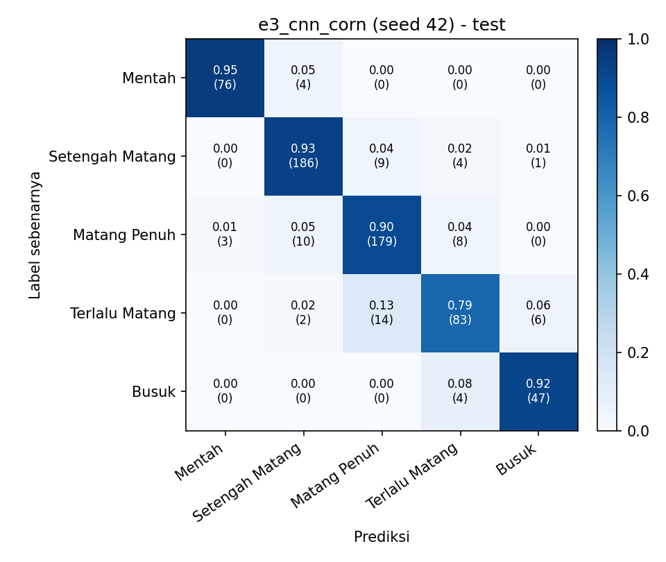
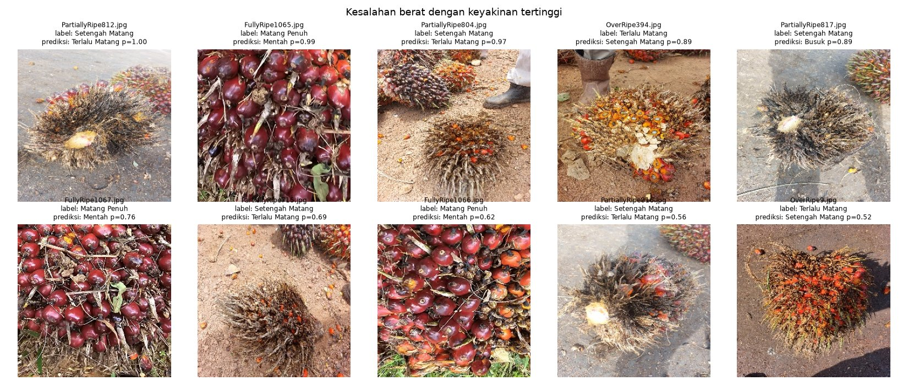
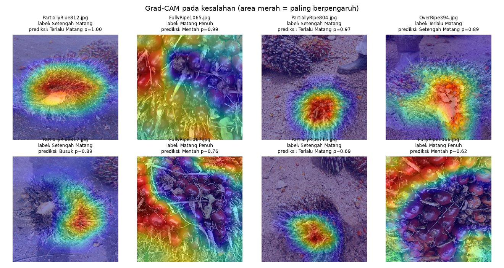

# Klasifikasi Ordinal Tingkat Kematangan Tandan Buah Segar Kelapa Sawit dari Citra Lapangan: Perbandingan Cross-Entropy dan CORN pada EfficientNet-B0

**Laporan Teknis Proyek Akhir (UAS)** · Visi Komputer IF0PP006 · Kelas 5PITA · Semester Ganjil 2026/2027

Kelompok 3: Juanito Dante (412024001), Yedija Teofilus Yonatan (412024011), Steven Iwan (412024010)

> **Status dokumen.** Seluruh angka berasal dari 22 run nyata (Google Colab, Tesla T4) dan disisipkan otomatis oleh `scripts/build_docs.py`. Teks pembahasan adalah **draf**: setiap anggota wajib membaca, memahami, dan menyunting sebelum dikumpulkan. Bagian **[…]** yang tersisa (kategori manual kesalahan, kontribusi anggota, atribusi) diisi kelompok. Hapus kotak ini pada versi final.

## Abstrak

Penilaian kematangan tandan buah segar (TBS) kelapa sawit masih dilakukan secara visual oleh petugas, sehingga hasilnya subjektif dan memengaruhi harga yang diterima pekebun. Tingkat kematangan bersifat berurutan, yaitu mentah, setengah matang, matang penuh, terlalu matang, dan busuk. Namun klasifikasi dengan *cross-entropy* (CE) memperlakukan semua kesalahan sama berat. Proyek ini membandingkan secara terkontrol CE dengan loss ordinal CORN pada EfficientNet-B0 pra-latih, memakai dataset terbuka berisi 4.728 foto lapangan dari Kalimantan Tengah beserta split resmi. Selain akurasi dan macro-F1, evaluasi memakai metrik yang memperhitungkan jarak kesalahan: MAE dalam satuan tingkat, proporsi kesalahan dua tingkat atau lebih, dan *quadratic weighted kappa*. Setiap konfigurasi diulang dengan tiga seed. Audit data menunjukkan bahwa foto bernomor berurutan umumnya berasal dari tandan atau sesi yang sama, dan 92% gambar uji pada split resmi memiliki tetangga langsung di data latih. Karena itu evaluasi utama memakai split blok yang menjaga foto berurutan tetap bersama, sedangkan split resmi menjadi pembanding. Kedua CNN jauh mengungguli baseline warna (macro-F1 sekitar 0,91 lawan 0,66). Namun CORN tidak lebih baik daripada CE: macro-F1 0,905 lawan 0,914 dan MAE 0,121 lawan 0,111, tanpa perbaikan yang konsisten antar seed. Pada split resmi, akurasi CNN tampak sekitar 5 poin lebih tinggi. Augmentasi *hue* menaikkan MAE dan kesalahan berat di ketiga seed. Model utama berjalan sekitar 12 ms per gambar di CPU dan disajikan dalam demo web dengan Grad-CAM. Temuan ini berlaku untuk foto lapangan dari satu wilayah dan belum menjamin kinerja pada foto tumpukan di pabrik.

*Kata kunci:* kelapa sawit, kematangan, klasifikasi ordinal, CORN, EfficientNet, kebocoran data

## 1. Pendahuluan

Indonesia adalah produsen minyak sawit terbesar di dunia. Mutu TBS yang diterima pabrik kelapa sawit dinilai terutama dari tingkat kematangan: buah mentah menurunkan rendemen minyak, sedangkan buah lewat matang atau busuk cenderung menaikkan asam lemak bebas. Penilaian dilakukan secara visual sehingga dapat berbeda antarpetugas. Karena isyarat kematangan (warna, tekstur, brondolan) dapat diamati dari foto, visi komputer berpotensi menjadi pendapat kedua yang konsisten.

Pekerjaan sebelumnya mengklasifikasikan kematangan TBS dengan CNN sebagai kelas nominal, termasuk pada perangkat seluler [5]. Dataset terbaru dari Kamal dkk. [1] secara eksplisit disusun sebagai data **ordinal**. Pada data ordinal, kesalahan "Mentah → Terlalu Matang" lebih merugikan daripada "Mentah → Setengah Matang". Metode ordinal seperti CORAL [3] dan CORN [2] memanfaatkan urutan tersebut, tetapi sepengetahuan kami belum dibandingkan secara terkontrol pada dataset ini.

Kontribusi proyek bersifat evaluatif, bukan algoritmik:

1. Perbandingan terkontrol CE vs CORN (satu-satunya perbedaan adalah kepala dan loss) dengan tiga seed dan metrik ordinal (**P1**).
2. Audit kebocoran yang menunjukkan foto beruntun dari tandan/sesi yang sama tersebar acak di split resmi, beserta split blok sebagai evaluasi yang lebih jujur dan ukuran besarnya optimisme split resmi (**P2**).
3. Uji pengaruh augmentasi warna terhadap isyarat kematangan (**P3**), satu iterasi perbaikan setelah analisis kesalahan (sampler seimbang), dan demo dengan latensi terukur.

## 2. Metodologi

### 2.1 Dataset

Dataset [1] (CC BY 4.0) berisi 4.728 foto JPG dalam lima kelas: Mentah 758, Setengah Matang 1.405, Matang Penuh 1.489, Terlalu Matang 665, dan Busuk 411. Foto diambil di lapangan dengan beragam perangkat, pencahayaan, dan latar, dan seluruhnya berukuran 256×256 piksel. Split resmi penyusun adalah split acak stratified 3.306/704/718 (Tabel 1). Gambar 1 memperlihatkan contoh tiap kelas.

**Tabel 1.** Distribusi kelas pada split resmi (diverifikasi dari arsip asli).

| Split | Mentah | Setengah Matang | Matang Penuh | Terlalu Matang | Busuk | Total |
|---|---|---|---|---|---|---|
| Train | 530 | 982 | 1.042 | 465 | 287 | 3.306 |
| Validasi | 113 | 210 | 222 | 98 | 61 | 704 |
| Test | 115 | 213 | 225 | 102 | 63 | 718 |

**Audit kebocoran.** Untuk setiap gambar dihitung MD5 dan dHash 64-bit. Hasilnya: 1 pasangan berkas identik dan 13 pasangan *near-duplicate* (jarak Hamming ≤ 5). Semua pasangan itu memang foto tandan yang sama dan bernomor berkas berurutan, tetapi hanya mencakup 6 gambar test (0,8%). Karena dHash hanya menangkap foto yang nyaris identik, kami juga mengukur kemiripan warna HSV antara gambar sekelas yang nomornya berselisih k, dibandingkan dengan pasangan acak (Gambar 2). Bila nomor tidak berkaitan dengan urutan pemotretan, sekitar 5% pasangan akan "sangat mirip"; ternyata angkanya 50% untuk k = 1 dan menurun perlahan hingga puluhan nomor. Foto bernomor berdekatan kemungkinan besar berasal dari tandan atau sesi yang sama, dan **92% gambar test resmi memiliki tetangga bernomor ±1 di train**. Ini adalah bentuk kebocoran data [9], [10].

**Split blok (split utama).** Nomor berkas setiap kelas dibagi menjadi blok berisi 20 nomor berurutan, blok digabung dengan kelompok dHash, lalu dibagi dengan *StratifiedGroupKFold* (seed 42) menjadi 3.434/658/636. Hanya 8,3% gambar test split blok yang bertetangga ±1 dengan train, yaitu yang berada di batas blok. Split ini disimpan sebagai berkas beku (`data/splits/grouped_split.csv`) karena hasil *StratifiedGroupKFold* berbeda antarversi scikit-learn (Bagian 3.6). Semua eksperimen utama memakai split blok; split resmi dipakai sebagai pembanding untuk mengukur optimismenya. Rincian audit ada di `results/audit/ringkasan_audit.md`.

<!-- include: results/audit/ringkasan_audit.md excerpt=Split_blok notitle -->

### 2.2 Baseline

E0 menebak kelas mayoritas. E1 memakai 40 fitur warna HSV (histogram H/S/V 18/8/8 bin serta rerata dan simpangan baku tiap kanal) dengan regresi logistik; C dipilih dari {0,01; 0,1; 1; 10; 100; 1000} berdasarkan macro-F1 validasi. E2 adalah EfficientNet-B0 [4] dengan kepala 5 logit dan *cross-entropy*.

### 2.3 Metode utama: EfficientNet-B0 + CORN

Kepala E3 menghasilkan K−1 = 4 logit. Logit ke-k memodelkan P(y > k | y > k−1), dan tugas k dilatih dengan BCE hanya pada sampel y ≥ k [2]. Peluang tak bersyarat P(y > k) adalah hasil kali kumulatif sigmoid sehingga monoton turun. Prediksi adalah jumlah k dengan P(y > k) > 0,5, sedangkan distribusi lima tingkat diperoleh dari selisih peluang kumulatif. Konfigurasi lain identik dengan E2 (Tabel 2, Gambar 3).

**Tabel 2.** Konfigurasi pelatihan bersama (`configs/base.yaml`).

| Komponen | Nilai | Alasan |
|---|---|---|
| Backbone | EfficientNet-B0, pra-latih ImageNet, *full fine-tuning* | ±4,0 juta parameter setelah kepala diganti; cocok untuk Colab gratis dan demo CPU |
| Input | latih: RandomResizedCrop 224 (skala 0,6–1); evaluasi: resize 256 + center crop 224 | standar transfer learning ImageNet |
| Augmentasi | flip H/V, rotasi ±15°, kecerahan & kontras ±0,2; hue = saturasi = 0 | warna adalah isyarat kematangan (diuji di E4) |
| Optimizer | AdamW, lr 3·10⁻⁴, *weight decay* 10⁻² | umum untuk *fine-tuning* |
| Jadwal | *warmup* 1 epoch + *cosine*; maks. 25 epoch; *early stopping* 7 | mencegah *overfitting* |
| Batch / presisi | 32 / *mixed precision* (GPU) | memori T4 |
| Pemilihan model | macro-F1 validasi terbaik | netral terhadap CE maupun CORN |
| Seed | 42, 43, 44 | variasi inisialisasi dan urutan data |

### 2.4 Eksperimen terkontrol dan metrik

Eksperimen E2–E5 memakai split blok. E4 menambahkan *hue* 0,1 dan saturasi 0,2 pada E3; E5 memakai *WeightedRandomSampler* seimbang kelas. E6 dan E7 adalah E2 dan E3 yang dilatih dan diuji pada split resmi. Baseline E0/E1 dijalankan pada kedua split. Metrik yang dipakai: akurasi, macro-F1, precision/recall per kelas, *confusion matrix*, MAE, proporsi kesalahan berat (|ŷ − y| ≥ 2), akurasi ±1, dan QWK [11]. Nilai disajikan sebagai rerata ± simpangan baku dari tiga seed. Test set dievaluasi sekali per run setelah checkpoint dipilih.

### 2.5 Lingkungan

Pelatihan dilakukan di Google Colab dengan GPU NVIDIA Tesla T4 16 GB, Python 3.13, dan PyTorch 2.11.0 (CUDA 13.0). Setiap run CNN memakan 7–15 menit. Baseline klasik juga dijalankan di Colab agar semua angka berasal dari satu lingkungan. Analisis kesalahan, latensi, dan demo dijalankan di laptop CPU AMD Ryzen 5 5600. Seluruh konfigurasi tersimpan per run (`config.yaml`, `summary.json`).

## 3. Hasil dan Pembahasan

### 3.1 Perbandingan utama (P1)

Tabel 3 merangkum baseline dan metode utama pada test split blok.

**Tabel 3.** Hasil utama pada split blok (rerata ± sd, 3 seed; nilai terbaik tebal).

<!-- include: results/tabel_utama.md notitle -->

**Tabel 4.** Selisih berpasangan per seed (E3 − E2).

<!-- include: results/tabel_berpasangan.md notitle -->

Kriteria minimum terpenuhi. Kedua CNN jauh mengungguli baseline warna: macro-F1 0,914 dan 0,905 lawan 0,657, serta MAE 0,11–0,12 lawan 0,51. Artinya isyarat tekstur dan bentuk yang dipelajari CNN memang menambah informasi di luar warna.

Namun **P1 terjawab negatif**. CORN tidak menurunkan MAE maupun kesalahan berat dibanding CE: MAE 0,121 ± 0,003 lawan 0,111 ± 0,006, dan kesalahan berat 1,9% lawan 1,7%. Secara berpasangan (Tabel 4), CORN tidak pernah memiliki MAE lebih rendah (0 dari 3 seed) dan hanya sekali memiliki kesalahan berat lebih rendah. Penurunan macro-F1 (−0,009) masih di dalam batas 0,02, tetapi kriteria target P1 tidak terpenuhi. Selisihnya kecil, sebanding dengan variasi antar seed, sehingga kesimpulan yang aman adalah bahwa CORN tidak memberi keuntungan pada data ini, bukan bahwa CORN lebih buruk. Dugaan penyebabnya: CE sudah jarang meleset jauh (akurasi ±1 tingkat 98,3%; kesalahan berat hanya 1,7%), sehingga ruang yang dapat diperbaiki oleh loss ordinal sangat kecil.

Gambar 4 membandingkan *confusion matrix* E2 dan E3 (seed 42).

Pada kedua model, massa kesalahan berada tepat di samping diagonal. Pada seed 42, 55 dari 65 kesalahan E3 (85%) hanya meleset satu tingkat, dan pola E2 serupa (51 dari 60). Pasangan yang paling sering tertukar adalah Terlalu Matang → Matang Penuh, serta Matang Penuh ↔ Setengah Matang. Terlalu Matang adalah kelas tersulit (recall rata-rata 0,848 pada E2 dan E3), sedangkan Mentah dan Busuk paling mudah dikenali (recall ≥ 0,95). Pola ini sejalan dengan perubahan visual yang paling jelas di kedua ujung skala (Tabel 5).

**Tabel 5.** Recall dan F1 per kelas.

<!-- include: results/tabel_per_kelas.md notitle -->

### 3.2 Kebocoran data (P2)

**Tabel 6.** Model yang sama pada split resmi (acak) dan split blok.

<!-- include: results/tabel_kebocoran.md notitle -->

Model warna E1 mendapat akurasi 1,0 poin dan macro-F1 2,4 poin lebih tinggi pada split resmi. Pada CNN selisihnya jauh lebih besar: akurasi +4,8 poin (CE) dan +5,3 poin (CORN), sementara MAE turun lebih dari separuh (0,111 → 0,051 untuk CE). Model yang lebih mampu menghafal tampak lebih diuntungkan oleh foto tandan yang sama di data latih, sesuai dugaan kebocoran.

Subset test "bersih" versi dHash (712 gambar) memberikan skor yang hampir sama dengan test penuh (E6: macro-F1 0,961 pada keduanya). Jadi membuang duplikat yang nyaris identik saja tidak menghilangkan optimisme ini; yang perlu dijaga adalah pemisahan per sesi pemotretan. Urutan CE dan CORN sama pada kedua split (CE sedikit lebih tinggi), sehingga kebocoran tidak mengubah kesimpulan P1, tetapi menggelembungkan angka absolutnya. Konsekuensinya, skor pada split acak resmi dataset ini sebaiknya dibaca sebagai batas atas, bukan perkiraan kinerja pada tandan atau sesi pemotretan baru.

### 3.3 Eksperimen augmentasi dan iterasi (P3, CP11)

**Tabel 7.** E3 vs E4 (hue jitter) dan E5 (sampler seimbang), split blok.

<!-- include: results/tabel_terkontrol.md notitle -->

Augmentasi *hue* dan saturasi (E4) tidak mengubah macro-F1 (0,905 pada keduanya), tetapi memperburuk metrik ordinal secara konsisten: MAE naik dari 0,121 menjadi 0,133 dan kesalahan berat dari 1,9% menjadi 2,6%, keduanya lebih buruk di ketiga seed. Hasil ini sejalan dengan hipotesis P3: mengacak warna merusak sebagian isyarat kematangan, terutama untuk membedakan tingkat yang berjauhan. Menariknya, pada data validasi E4 justru tampak terbaik (macro-F1 validasi 0,893 lawan 0,880). Artinya data validasi (658 foto dari sedikit sesi) kurang andal untuk memilih konfigurasi.

Sampler seimbang (E5) tidak memperbaiki rata-rata (macro-F1 0,903, MAE 0,125). Recall Busuk naik (0,948 → 0,961) dan recall Matang Penuh juga naik, tetapi recall Terlalu Matang dan Mentah turun, sehingga sampler hanya memindahkan kesalahan antarkelas.

**Keputusan konfigurasi akhir:** demo tetap memakai E3 seed 42 sesuai rencana. Kami tidak berpindah konfigurasi berdasarkan skor test, karena itu sama dengan memakai data uji untuk memilih model; selisih E3 dengan E2 juga kecil.

### 3.4 Analisis kesalahan

<!-- include: results/analisis_kesalahan/e3_cnn_corn_seed42/ringkasan.md notitle -->

Grad-CAM (Gambar 6) menunjukkan bahwa pada sebagian besar kesalahan, perhatian model berada pada tandan, bukan pada latar seperti tanah, sepatu, atau tandan lain. Jadi kesalahan tidak terjadi karena model melihat objek yang salah. Ada tiga pola yang menonjol:

1. **Kesalahan berkelompok per sesi pemotretan.** Sepuluh kesalahan berat E3 berasal dari hanya 5 dari 33 blok test, dan 4 di antaranya dari satu blok (PartiallyRipe800–819).
2. **Dugaan ambiguitas label pada sesi tertentu.** Beberapa foto berlabel Setengah Matang di blok tersebut tampak sebagai tandan kering berduri dengan sedikit buah, sehingga prediksi Terlalu Matang/Busuk dapat dimengerti secara visual. Ini perlu dikonfirmasi ahli; ini bukan bukti salah label.
3. **Close-up ekstrem.** Foto close-up tanpa bentuk tandan utuh (FullyRipe1065–1067) diprediksi Mentah. Perhatian model jatuh pada buah merah tua yang tampak gelap, sehingga pembingkaian dan pencahayaan ikut berperan.

Sampler seimbang (E5) diuji sebagai iterasi perbaikan untuk kelas kecil, tetapi tidak memperbaiki rata-rata (Bagian 3.3). Kategori manual seluruh 65 kesalahan: **[isi dari `kategori_manual.csv`: jumlah per kategori]**.

### 3.5 Demo dan latensi

Demo Gradio (`app/app.py`) menerima foto baru dan menampilkan tingkat prediksi, peluang tiap tingkat, nilai harapan tingkat, Grad-CAM [8], latensi, serta peringatan bila keyakinan < 0,9. Ambang ini diubah dari rencana awal 0,5 berdasarkan data **validasi**. Pada ambang 0,5 hanya 0,2% foto validasi yang ditandai, sehingga peringatan hampir tidak pernah muncul. Pada ambang 0,9, 13,2% foto ditandai, dan hanya 50,6% di antaranya benar, sedangkan sisanya 93,2% benar. Data uji menunjukkan pola yang sama: 15,3% ditandai dengan akurasi 66,0%, dan sisanya 94,1% benar. Cadangan teknisnya adalah CLI `scripts/predict.py`. Latensi diukur dengan batch 1, input 224×224, 10 iterasi pemanasan, dan 100 iterasi terukur (Tabel 8).

**Tabel 8.** Latensi model utama.

<!-- include: results/latensi/latensi_e3_cnn_corn_cpu.md notitle -->

Latensi model sekitar 12 ms per foto di CPU laptop, jauh di bawah target 200 ms. Latensi GPU tidak diukur karena sesi Colab terputus sebelum sel latensi dijalankan; untuk demo, CPU sudah lebih dari cukup.

### 3.6 Keterbatasan

- Satu sumber data (satu wilayah, satu tim pelabel); tidak ada uji lintas dataset (mis. [6], [7]).
- Tiga seed memberi gambaran variasi, tetapi belum cukup untuk uji signifikansi yang kuat.
- Hubungan "nomor berurutan = tandan/sesi sama" disimpulkan dari kemiripan statistik dan pemeriksaan visual sampel; label manual tim pada 40 pasangan acak mengonfirmasinya (18 tandan sama, 11 berbeda, 11 ragu; 62% tandan sama di antara yang dapat diputuskan, IK 95% 44–77%). Dari 18 pasangan tandan sama, 6 terpisah antara train dan val/test pada split resmi dan 0 pada split blok. Sampel ini kecil dan pelabelnya bukan ahli sawit. Split blok mengurangi, tetapi tidak menghapus, kemiripan sesi antara train dan test (kemiripan masih di atas acak hingga selisih 50 nomor).
- Ukuran blok (20) dan ambang dHash (5) dipilih secara heuristik (lihat `results/audit/sensitivitas_ambang.csv`).
- Keyakinan model belum dikalibrasi; ambang peringatan demo bersifat heuristik.
- Data validasi (658 foto dari sedikit sesi) kurang andal untuk memilih konfigurasi: peringkat E3 dan E4 berbeda antara validasi dan test.
- Kesalahan berkelompok per sesi. Dengan hanya 33 blok di test, skor test ikut bergantung pada sesi mana yang kebetulan masuk test. Validasi silang berkelompok akan memberi perkiraan yang lebih stabil.
- Split blok yang dihitung ulang bergantung pada versi scikit-learn: versi ≤ 1.7 menghasilkan 3.434/658/636, sedangkan ≥ 1.8 menghasilkan 3.368/680/680 dari input dan seed yang sama. Karena itu split dibekukan sebagai berkas. Nilai E1 pada split resmi juga sedikit berbeda antara Colab dan laptop (macro-F1 0,681 lawan 0,671), kemungkinan karena perbedaan versi pustaka. Semua angka laporan berasal dari satu lingkungan (Colab).
- Latensi GPU tidak diukur.

## 4. Kesimpulan

Pada 4.728 foto lapangan dari Kalimantan Tengah, EfficientNet-B0 pra-latih mencapai macro-F1 sekitar 0,91 pada split blok dengan hanya ±2% kesalahan berat. Hasil ini jauh di atas baseline warna (0,66), dan model berjalan sekitar 12 ms per foto di CPU laptop. Namun hipotesis utama tidak terbukti (P1): loss ordinal CORN tidak menurunkan MAE maupun kesalahan berat dibanding *cross-entropy*, kemungkinan karena CE sudah hampir selalu meleset paling jauh satu tingkat. Audit data menunjukkan bahwa split acak resmi menggelembungkan akurasi CNN sekitar 5 poin, karena foto beruntun dari tandan yang sama tersebar ke data latih dan uji (P2). Karena itu, angka pada split resmi sebaiknya dibaca sebagai batas atas. Augmentasi warna memperburuk metrik ordinal di ketiga seed (P3), yang mendukung keputusan untuk tidak mengacak hue. Konfigurasi akhir demo adalah E3 (CORN) seed 42 sesuai rencana, dengan ambang peringatan 0,9 yang dipilih dari data validasi. Klaim ini terbatas pada satu dataset dari satu wilayah dan belum menjamin kinerja pada foto tumpukan di pabrik atau kondisi pemotretan lain.

**Pekerjaan lanjutan.** Uji lintas dataset (foto tumpukan di PKS [6] dan dataset luar ruangan [7]), validasi silang berkelompok per sesi, konfirmasi label sesi yang ambigu oleh ahli, kalibrasi keyakinan (*temperature scaling*), dan kuantisasi untuk perangkat seluler.

## Kontribusi anggota

| Anggota | Kontribusi | Bukti |
|---|---|---|
| Yedija Teofilus Yonatan | **[isi]** | **[tautan logbook/commit]** |
| Juanito Dante | **[isi]** | **[tautan logbook/commit]** |
| Steven Iwan | **[isi]** | **[tautan logbook/commit]** |

**Atribusi bantuan eksternal.** Kerangka kode dan dokumen awal proyek disusun dengan bantuan asisten AI (Claude, Anthropic), lalu diperiksa, dijalankan, dan dimodifikasi oleh kelompok. **[Rinci bagian yang diubah kelompok.]** Pustaka yang dipakai tercantum di README.

## Referensi

1. Kamal, I. M., Mochammad, S., Nurahmi, L., Natawijaya, A., & Kalili, M. (2024). *An ordinal dataset for ripeness level classification in oil palm fruit quality grading* (Version 1) [Data set]. Mendeley Data. https://doi.org/10.17632/424y96m6sw.1
2. Shi, X., Cao, W., & Raschka, S. (2023). Deep neural networks for rank-consistent ordinal regression based on conditional probabilities. *Pattern Analysis and Applications, 26*(3), 941–955. https://doi.org/10.1007/s10044-023-01181-9
3. Cao, W., Mirjalili, V., & Raschka, S. (2020). Rank consistent ordinal regression for neural networks with application to age estimation. *Pattern Recognition Letters, 140*, 325–331. https://doi.org/10.1016/j.patrec.2020.11.008
4. Tan, M., & Le, Q. V. (2019). EfficientNet: Rethinking model scaling for convolutional neural networks. *Proceedings of the 36th International Conference on Machine Learning*, PMLR 97, 6105–6114.
5. Suharjito, Elwirehardja, G. N., & Prayoga, J. S. (2021). Oil palm fresh fruit bunch ripeness classification on mobile devices using deep learning approaches. *Computers and Electronics in Agriculture, 188*, 106359. https://doi.org/10.1016/j.compag.2021.106359
6. Suharjito, Junior, F. A., Koeswandy, Y. P., Debi, Nurhayati, P. W., Asrol, M., & Marimin. (2023). Annotated datasets of oil palm fruit bunch piles for ripeness grading using deep learning. *Scientific Data, 10*, 72. https://doi.org/10.1038/s41597-023-01958-x
7. Omar, Z., Abdul Majeed, A. P. P., Rosbi, M., Ghazalli, S. A., & Selamat, H. (2024). Outdoor oil palm fruit ripeness dataset. *Data in Brief, 55*, 110667. https://doi.org/10.1016/j.dib.2024.110667
8. Selvaraju, R. R., Cogswell, M., Das, A., Vedantam, R., Parikh, D., & Batra, D. (2017). Grad-CAM: Visual explanations from deep networks via gradient-based localization. *ICCV 2017*, 618–626. https://doi.org/10.1109/ICCV.2017.74
9. Kaufman, S., Rosset, S., Perlich, C., & Stitelman, O. (2012). Leakage in data mining. *ACM Transactions on Knowledge Discovery from Data, 6*(4), 1–21. https://doi.org/10.1145/2382577.2382579
10. Kapoor, S., & Narayanan, A. (2023). Leakage and the reproducibility crisis in machine-learning-based science. *Patterns, 4*(9), 100804. https://doi.org/10.1016/j.patter.2023.100804
11. Cohen, J. (1968). Weighted kappa: Nominal scale agreement provision for scaled disagreement or partial credit. *Psychological Bulletin, 70*(4), 213–220. https://doi.org/10.1037/h0026256
